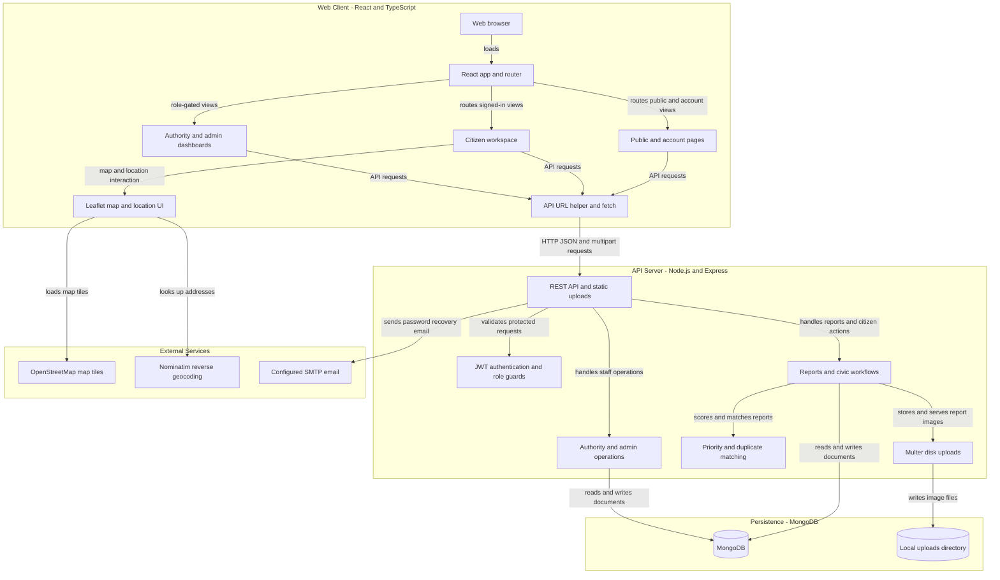
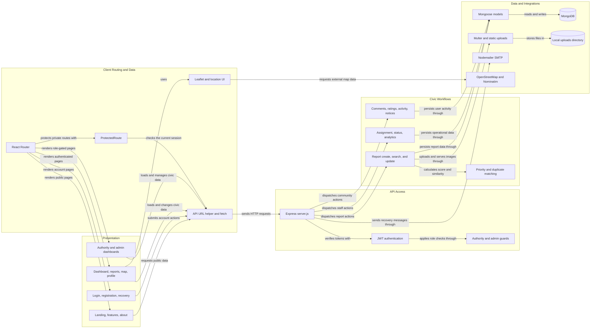

# Architecture Diagram

CitiZen is a civic issue reporting platform with a React web client and a Node.js API. These diagrams summarize the implemented page groups, request paths, access controls, data stores, and external services.

## Application Architecture

<!-- mermaid-checked: no \n, no em-dash/en-dash, no {} in labels, subgraphs are id["label"], arrows are -->|"label"|, all subgraphs closed by end, ids unique -->

### Technology Stack Summary

| Layer | Technology | Version | Purpose |
|---|---|---|---|
| Web UI | React | ^19.2.8 | Client-rendered website |
| Web UI | TypeScript | ~6.0.2 | Frontend type checking |
| Routing and build | React Router, Vite | ^7.18.2, ^8.2.0 | Page navigation and frontend build |
| Styling and maps | Tailwind CSS, Leaflet | ^4.3.3, ^1.9.4 | Styling and interactive maps |
| API | Node.js, Express | Runtime not pinned, ^5.2.1 | REST API and static upload serving |
| Persistence | MongoDB, Mongoose | MongoDB server version not pinned, ^9.9.1 | Document storage and models |
| Authentication | JSON Web Token, bcryptjs | ^9.0.3, ^3.0.3 | Signed sessions and password hashing |
| File handling | Multer | ^2.2.0 | Local image upload handling |
| Email | Nodemailer | ^10.0.10 | Password recovery email via configured SMTP |
| Map services | OpenStreetMap, Nominatim | External services | Map tiles and reverse geocoding |

### Data Storage & External Services

The backend persists users, reports, comments, notifications, report activity, authority ratings, and audit logs in MongoDB through Mongoose. Multer stores uploaded images in the backend's local `uploads` directory, which Express serves as static content; report documents hold image URLs. The browser requests map tiles from OpenStreetMap and reverse-geocodes selected coordinates through Nominatim. The backend uses configured SMTP through Nodemailer for password recovery. No external AI provider is wired into the inspected report flow; priority scoring and similar-report matching are application logic.

### Key Architectural Decisions

- The API is implemented as a single Express server entry point, with Mongoose models and middleware in separate files.
- JWT authentication reloads the current user from MongoDB; authority and admin access is role-gated.
- Report prioritization and duplicate/similarity matching are handled within the application, not by an external AI service.

## Component Relationships

<!-- mermaid-checked: no \n, no em-dash/en-dash, no {} in labels, subgraphs are id["label"], arrows are -->|"label"|, all subgraphs closed by end, ids unique -->

### Component Inventory

| Component | Layer | Type | Responsibility |
|---|---|---|---|
| Landing, features, about | Presentation | React pages | Public product and informational pages |
| Login, registration, recovery | Presentation | React pages | Account creation, login, and password recovery |
| Dashboard, reports, map, profile | Presentation | React pages | Citizen reporting, tracking, discovery, and account view |
| Authority and admin dashboards | Presentation | React pages | Staff report queues, administration, and oversight |
| React Router | Client routing | Router | Maps URL paths to page components |
| ProtectedRoute | Client access | Route guard | Checks session and optional role before rendering private pages |
| API URL helper and fetch | Client data | URL helper and browser API | Builds API URLs; page components issue HTTP requests with fetch |
| Leaflet and location UI | Client integration | Map components | Displays map tiles and supports location selection |
| Express server.js | API | HTTP server | Hosts REST endpoints and serves uploaded images |
| JWT authentication | API access | Middleware | Verifies bearer token and loads the current active user |
| Authority and admin guards | API access | Middleware | Limits privileged API operations by role |
| Report workflows | Business logic | API handlers | Creates, lists, updates, and evaluates civic reports |
| Staff operations | Business logic | API handlers | Assignment, status transitions, and administration |
| Community workflows | Business logic | API handlers | Comments, ratings, activity history, and notifications |
| Priority and duplicate matching | Business logic | Application logic | Calculates priority and finds nearby similar reports |
| Mongoose models | Data access | ODM models | Defines persisted entities and document relationships |
| MongoDB | Data storage | Document database | Stores platform records |
| Multer and static uploads | File handling | Upload middleware | Writes and serves report image files |
| Nodemailer SMTP | External integration | Email transport | Sends password recovery messages |
| OpenStreetMap and Nominatim | External integration | Map services | Supplies map tiles and reverse-geocoded addresses |
